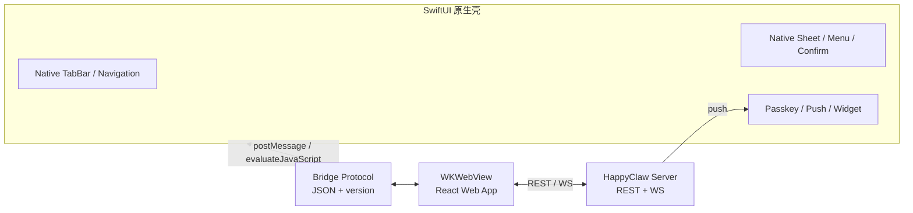

# iOS 原生质感方案

## 目标

在**不重写聊天和业务页面**的前提下，让 HappyClaw 在 iPhone 上有接近原生 App 的体验：

- 原生 TabBar、导航栈、边缘返回、原生 Sheet、上下文菜单、分享、选图、触感
- 原生 Passkey/Face ID、推送、角标、Widget
- iOS 26 支持 Liquid Glass
- 普通浏览器/PWA 完全不受影响

## 非目标

- 不用 SwiftUI 重写消息列表、Markdown、流式渲染
- 不做两套业务逻辑
- 不在第一版做 iPad 专门布局
- 不在第一版做 App Store 上架

## 总体架构



**职责边界**

- **原生**：窗口、TabBar、导航栈、返回手势、Sheet、菜单、确认框、分享、选图、Passkey、推送、Widget、安全区、键盘、触感、Liquid Glass
- **Web**：路由内容、聊天、Markdown、文件预览、任务/技能/MCP/设置页面、业务弹窗内容
- **桥接**：只传“声明”和“结果”，不传业务数据；权限过滤在 Web 侧完成

## 原生壳组件

建议目录（新建 iOS 工程，SwiftUI，iOS 17+）：

```
ios/HappyClaw/
  App.swift
  RootShell.swift              // TabView + NavigationStack + WebView 容器
  NativeTabBar.swift            // 原生底部 Tab
  WebHostView.swift             // WKWebView 封装、cookie、导航代理
  Bridge/
    BridgeProtocol.swift        // 消息类型/版本/编解码
    BridgeSession.swift         // 握手、状态机、错误恢复
    LayoutBridge.swift          // contentInsets/safeArea/keyboard -> CSS 变量
    SheetHost.swift             // UISheetPresentationController
    MenuBridge.swift            // 原生操作菜单/上下文菜单
    ConfirmBridge.swift         // 原生确认框
  Auth/
    PasskeyAuthenticator.swift  // ASAuthorization
  Push/
    PushManager.swift           // APNs 或 Web Push 协调
  Recovery/
    RecoveryView.swift          // 桥接失败/服务不可达
```

**MVP 原生组件**
- `TabView`/自定义 TabBar：会话、工作台、任务、能力、我的
- `NavigationStack` + 边缘返回手势
- `WKWebView`：持久化 `WKWebsiteDataStore`，共享 cookie
- 原生 Sheet：medium/large + grabber
- 原生确认框/操作菜单
- `UIActivityViewController` 分享
- `PhotosPicker` / `UIDocumentPicker` 选图/选文件
- `ASAuthorization` Passkey
- Haptics、安全区、键盘遮挡
- iOS 26：`.prominentGlass()`（可用性判断）

**后续**
- 长按上下文菜单（会话/消息/文件）
- 原生搜索页
- WidgetKit、Live Activity
- 原生通知中心入口（可选）

## Web 侧桥接模块

建议新增：

```
web/src/native/
  protocol.ts      // 消息类型、版本、校验
  session.ts       // 握手、能力协商、重连
  layout.ts        // 接收 insets -> data-native-chrome + CSS 变量
  registry.ts      // 声明注册表（权限过滤后的 actions/menus/sheets）
  header.ts        // 页面标题/Tab/动作声明
  sheet.ts         // Sheet 声明与结果回调
  menu.ts          // 操作菜单声明
  confirmation.ts  // 确认框声明
  theme.ts         // 主题/配色同步
```

**核心规则**
- 不靠 UA 猜“是不是 App”；只有桥接事务提交后才启用 `data-native-chrome="active"`
- 原生接管时，Web 隐藏自己的 header、TabBar、底部导航、卡片菜单触发点
- Web 内容用 `--native-top/right/bottom/left`、`--native-keyboard-occlusion` 避让
- 原生面板只拿“权限过滤后的展示声明”，业务动作回调到 Web 执行

## 桥接协议（v1 草案）

**Web → 原生**

```json
{"v":1,"type":"native.hello","capabilities":["tabbar","nav","sheet","share","picker","passkey","push","widget"]}
{"v":1,"type":"route.changed","path":"/chat/xxx","title":"会话","canGoBack":true}
{"v":1,"type":"header.tabs","items":[{"id":"chat","title":"会话","active":true}]}
{"v":1,"type":"actions","items":[{"id":"new-chat","title":"新会话","icon":"plus"}]}
{"v":1,"type":"sheet.open","sheet":{"id":"model-picker","title":"选择模型","detents":["medium","large"],"content":"/sheet/model-picker"}}
{"v":1,"type":"confirm","id":"c1","title":"删除会话？","message":"不可恢复","destructive":true}
{"v":1,"type":"layout.insets","contentInsets":{"top":44,"bottom":34},"systemSafeArea":{"top":47,"bottom":34},"keyboardOcclusion":0}
```

**原生 → Web**

```json
{"v":1,"type":"nav.back"}
{"v":1,"type":"action.invoke","id":"new-chat"}
{"v":1,"type":"sheet.result","id":"model-picker","value":"claude-sonnet"}
{"v":1,"type":"confirm.result","id":"c1","confirmed":true}
{"v":1,"type":"auth.passkey.result","ok":true}
{"v":1,"type":"theme.changed","scheme":"dark"}
{"v":1,"type":"bridge.error","code":"layout_invalid","message":"..."}
```

**状态机**

```
webNavigation -> negotiating -> prepared -> nativeNavigation -> releasing -> recovery
```

- 握手失败或前端版本不兼容：显示**原生恢复页**，不进入半原生状态
- 原生布局事务提交前，Web 保持普通浏览器布局（避免闪烁/双层 chrome）
- 断线/后台恢复：原生保留 route，Web 重连 WS 并拉增量

## 布局与安全区

- 原生计算 `contentInsets`（导航/TabBar 占用 + 系统安全区）和 `keyboardOcclusion`，发给 Web
- Web 设置：
  - `document.documentElement.dataset.nativeChrome = 'active'`
  - `--native-top/left/bottom/right`
  - `--native-keyboard-occlusion`
- Web 的 header/TabBar 在原生模式下 `display:none`；内容区按变量加 padding
- 旋转/分屏：原生重新发 layout，Web 用 `ResizeObserver` 更新
- 不在 Web 里再叠加 `env(safe-area-inset-*)`（原生已经算过），避免双倍留白

## 导航

- 原生拥有路由栈；Web 的 react-router 负责内容
- Web 路由变化 → `route.changed`；原生更新标题/返回按钮/Tab 选中
- 原生返回手势 → 优先 `nav.back` 让 Web 退栈；Web 已到根则原生 pop
- 深链：推送/Widget 带 `path`，原生启动后直接 `route.changed` 到目标
- 避免双 history：原生不自己维护一份 Web 路由，只镜像

## Sheet / 菜单 / 确认框

**MVP 策略**
- 简单列表/动作（模型选择、会话操作、文件操作）→ 原生 Sheet；内容用子 WKWebView 或轻量 React 路由
- 复杂业务弹窗（表单、预览、插件 UI）→ 继续在 WebView 内，原生只接管标题/关闭/动画（参考 MP 的 `NativeWebSheetController`）
- 确认框/操作菜单 → 原生渲染，Web 只发声明和收结果

**后续**
- 统一到 MP 的做法：同一个 WebView + 占位/恢复，减少子 WebView 的状态分叉

## 登录与 Passkey

- WebView 使用持久 `WKWebsiteDataStore`，登录 cookie 与浏览器一致
- 401 → Web 跳登录；原生不拦截（避免双登录）
- Passkey：
  - 原生 `ASAuthorizationPlatformPublicKeyCredentialProvider`
  - Web 提供 `native-passkey.html` 桥接页（参考 MP）
  - 失败回退密码登录
- Face ID/Touch ID 仅用于本地解锁可选，不替代服务端会话

## 推送

**两条路，先选一条**

| 方案 | 优点 | 限制 | 后端 |
|---|---|---|---|
| Web Push（PWA） | 不需要 APNs 证书；iOS 16.4+ 主屏 PWA 支持 | 必须“添加到主屏幕”；后台投递受 iOS 限制；无 App 时体验弱 | VAPID 密钥、订阅表、发送服务 |
| APNs（原生） | 可靠、可角标、可深链、体验最好 | **需要付费 Apple Developer 账号**、证书/Key、device token | APNs Key、token 表、发送服务 |

**建议**
- 先做 **Web Push** 验证需求（成本低，PWA 也能用）
- 如果原生壳上线且推送是刚需，再加 APNs
- 推送事件：任务完成/失败、审批请求、后台任务结果；点通知深链到会话
- 去重/静默：同一任务只推一次；前台时走通知中心，不弹系统通知

## Widget / Live Activity

- WidgetKit 扩展，读取 App Group 共享快照
- 第一版：未读数、运行中任务数、今日用量
- 刷新：时间线 + 后端事件触发（可选）
- 注意：Widget/推送在免费自签账号上可能不可用，需真机验证；付费账号更稳

## 后台与恢复

- 原生记录 route、滚动位置、输入草稿（Web 已有草稿）
- 回前台：重连 WS、拉增量、恢复滚动
- WebView 被系统回收：原生恢复页 + 重新加载 + 恢复 route
- 服务不可达：原生恢复页显示“重试/改地址/查看状态”，不白屏
- 离线：PWA 离线页；原生壳可缓存最近会话快照（后续）

## 版本与兼容

- 最低 iOS 17；iOS 26 才启用 Liquid Glass（`.prominentGlass()`）
- 桥接协议带 `v`，前端/原生都能拒绝不兼容版本
- 原生功能用 capability 协商：`tabbar`、`sheet`、`passkey`、`push`、`widget`
- Web 在浏览器/PWA/原生三种模式下都能工作；原生模式失败自动回退

## 分发与签名

- **个人使用**：SideStore/AltStore 自签，免费 Apple ID，7 天续签；适合没有付费开发者账号的情况
- **需要推送/Widget/长期稳定**：付费 Apple Developer Program（$99/年），TestFlight 或 Ad Hoc
- **App Store**：本轮不做；如果以后上架，需要隐私政策、审核、IAP 规则评估
- 续签自动化：SideStore 的配对/刷新流程，或 AltStore + 电脑；文档化

## 许可

- **MoviePilot-App 是 GPL-3.0-only**：不要直接复制 Swift 代码，否则会把 GPL 带进 HappyClaw；借架构、协议、交互自己实现
- **MoviePilot-Frontend 是 MIT**：可以参考/改写，保留版权与许可声明
- HappyClaw 自身许可证需确认；如果以后分发，先做许可证审计

## 测试计划

**原生**
- 单元：桥接编解码、状态机、layout 计算、恢复逻辑
- UI：启动、登录、Tab 切换、发送消息、Sheet、分享、选图、Passkey、推送深链
- 设备：iPhone 刘海/灵动岛各一台；iOS 17/18/26 至少各一台（或模拟器 + 一台真机）
- 弱网/断网/后台回收/旋转/键盘

**Web**
- Playwright 模拟 native 模式：设置 `data-native-chrome` + `--native-*`，验证无双层导航、内容不遮挡
- 桥接协议单测（Vitest）：消息校验、版本拒绝、权限过滤
- 回归：聊天流式、文件预览、任务、设置

## 验收标准

- App 加载你的 HappyClaw 地址，登录态保持
- 原生 TabBar/导航/边缘返回/Sheet 正常，无双层 chrome
- 分享、选图、Passkey 可用
- 聊天流式输出正常；后台回来不丢会话
- 桥接失败/服务不可达有原生恢复页
- 推送 <5s 到达并可深链（Phase 4）
- Widget 刷新正常（Phase 4）
- 真机 crash-free sessions ≥ 99.5%（个人基线）

## 风险

- **桥接复杂**：先做最小协议，版本化，失败回退
- **双层导航**：原生接管时 Web 必须隐藏 chrome；用 `data-native-chrome` 统一控制
- **登录/cookie**：WKWebView 与浏览器行为不同；第一周就验证登录闭环
- **WKWebView 性能**：长会话靠 Web 虚拟列表；原生不要重复渲染
- **后台挂起**：iOS 会冻结 WebView；必须做重连/恢复
- **推送证书/付费账号**：免费自签可能不支持 Push/Widget；提前验证
- **7 天续签**：SideStore 自动化，否则掉签
- **GPL 污染**：只借架构，不复制 MP-App 代码
